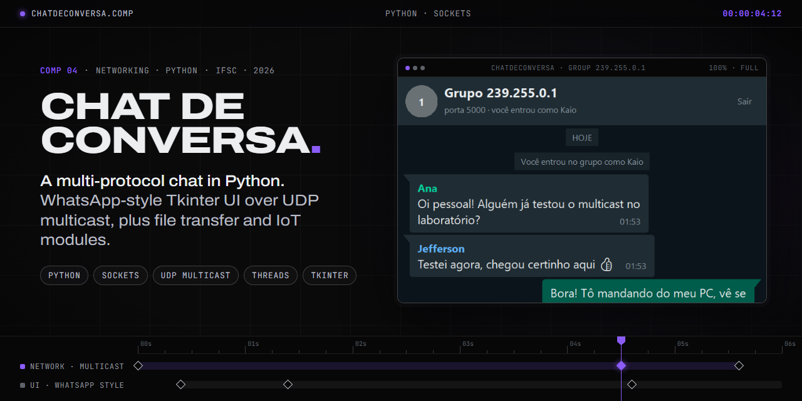
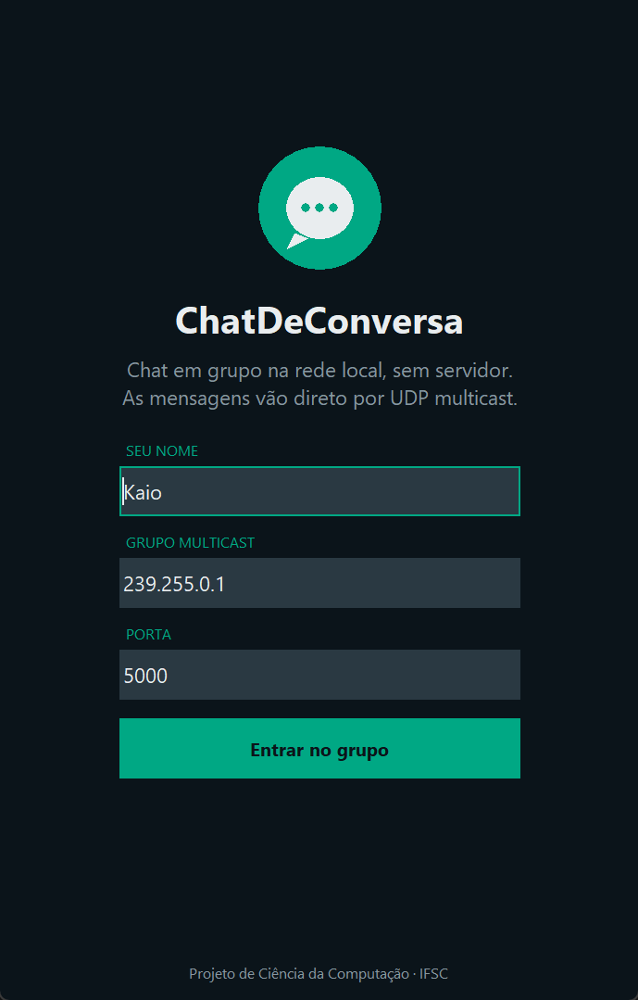

<div align="center">

**English** · [Português (Brasil)](README.pt-BR.md)

</div>



# ChatDeConversa

A multi-protocol chat application in Python, built as a hands-on project for the Computer Science program at IFSC (Federal Institute of Santa Catarina, Brazil).

The main app is a group chat over **UDP multicast** with a **WhatsApp-style** interface built in **Tkinter**: an entry screen with name, group and port, and a conversation view with bubbles, a colour per sender, timestamps and blue double checks once your message reaches the group. There is no server: each message goes straight to everyone on the local network who joined the same group (default `239.255.0.1`, port `5000`). The other modules explore two more protocols: client/server **file transfer** and an **IoT** client/server pair configured per branch office.

<p align="center">
  
  &nbsp;
  
</p>

<sub>The interface text is in Portuguese.</sub>

### How the interface works

- **Bubbles** drawn on a `Canvas`, with rounded corners and a tail on the sender's side.
- **Blue double checks**: every message carries an `id`; when the multicast echo comes back to the sender, ✓ turns into ✓✓.
- **Thread-safe**: the network thread only puts incoming messages on a `queue.Queue`; the UI drains the queue with `after()` and never touches Tkinter from another thread.
- **Backward compatible** with the old message format (`date`, `time`, `username`, `message`); the new fields (`id`, `client`) are optional.
- **Sharp on scaled displays** (Windows at 125% or 150%).

## Modules

| Folder | What it does |
| :-- | :-- |
| `MainChat.py` | Entry point: opens the chat. |
| `chat/` | `ChatApp.py`: the WhatsApp-style UI and the multicast networking (sending, threaded receiving, delivery checks). |
| `ftp/` | `FileServer.py` and `FileClient.py`, sending and receiving files over sockets. |
| `iot/` | `IoTServer.py` and `IoTClient.py`, with per-branch JSON configs. |

## Technologies

- **Python** with the standard library only: `socket`, `threading`, `queue`, `json`, `tkinter`
- **UDP multicast** for the group chat
- **TCP** for file transfer and **UDP** for the IoT module

## Running it

```bash
git clone https://github.com/KaioHomem/ChatDeConversa.git
cd ChatDeConversa
python MainChat.py
```

Open it on two machines (or two terminals) on the same network, join the same group and port, and chat.

## Author

**Kaio Felipe Homem** · [Portfolio](https://kaiohomem.github.io) · [GitHub](https://github.com/KaioHomem)

<sub>Academic project · IFSC · Computer Science</sub>
